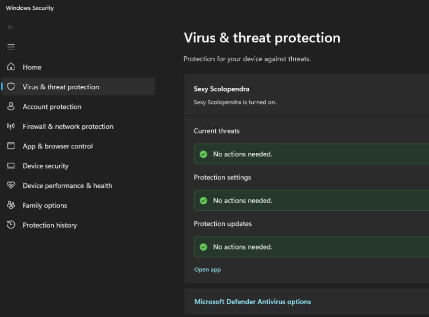

TODO fully port to the new repo instead of this DMCAable mess

# AV

Disable Windows Defender and everything around it, this is effectively a "pointless" fork of the [original repo](https://github.com/es3n1n/defendnot) which you should use, I just want to build my own binaries.



## How it works

There's a WSC (Windows Security Center) service in Windows which is used by antiviruses to let Windows know that there's some other antivirus in the hood and it should disable Windows Defender.

This WSC API is undocumented and furthermore requires people to sign an NDA with Microsoft to get its documentation.

With a little bit of reverse engineering of a real AV's WSC implementation, it got turned into a service that can add your own AV module.

## Limitations

To keep this WSC stuff even after reboot, the project adds itself (not really itself, but rather a real AV's module) to the autorun. Thus, you need to keep the binaries on your disk.

## Usage
```commandline
Usage: no-defender-loader [--help] [--version] [--disable] [--firewall] [--av] [--name VAR]

Optional arguments:
  -h, --help     shows help message and exits
  -v, --version  prints version information and exits
  --disable      re-enable firewall/Defender
  --firewall     disable firewall
  --av           disable Defender
  --name         av name [default: "Sexy Scolopendra"]
```

To only disable Defender, simply launch Powershell as admin and run `.\no-defender-loader.exe --av` from the directory you saved the artifact to.

You cannot delete the directory afterwards, as detailed above.

## License
GPL-3.0-only
