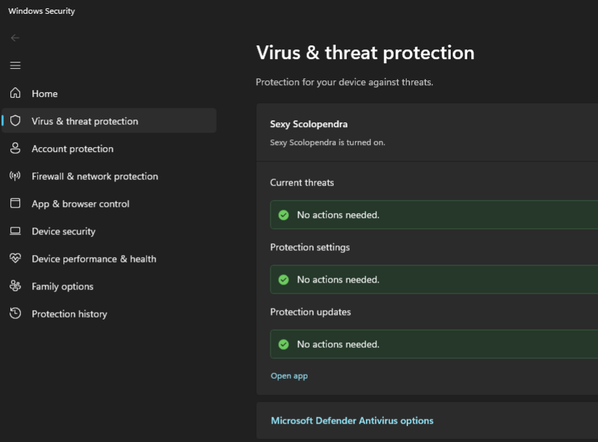

# AV


Disable Windows Defender and everything around it, this is effectively a "pointless" fork of the [original repo](https://github.com/es3n1n/defendnot) which you should use, I just want to build my own binaries.



## How it works

There's a WSC (Windows Security Center) service in Windows which is used by antiviruses to let Windows know that there's some other antivirus in the hood and it should disable Windows Defender.

This WSC API is undocumented and furthermore requires people to sign an NDA with Microsoft to get its documentation.

With a little bit of reverse engineering of a real AV's WSC implementation, it got turned into a service that can add your own AV module.

Writeup: [How I ruined my vacation by reverse engineering WSC](https://blog.es3n1n.eu/posts/how-i-ruined-my-vacation/)

## Limitations

- **Needs to stay on disk:**
  To keep the AV registration after reboot, defendnot adds itself to autorun. Thus, you need to keep the binaries on your disk.

## Installation

> [!WARNING]
> You may need to temporarily disable realtime and tamper protection before proceeding, otherwise Defender will block defendnot binaries from running.
>
> You may also have to turn off Smart App Control on newer Windows 11 builds.
>
> - Real-time protection: `windowsdefender://threatsettings/`
> - Smart App Control: `windowsdefender://appbrowser/`

### One-liner

Open the powershell as administrator and execute any of these:

```powershell
# Example 1: Basic installation
irm https://raw.githubusercontent.com/C0rn3j/AV/refs/heads/main/install.ps1 | iex

# Example 2: With custom AV name and firewall
& ([ScriptBlock]::Create((irm https://raw.githubusercontent.com/C0rn3j/AV/refs/heads/main/install.ps1))) --name "Custom AV name" --firewall

# Example 3: Without allocating console
& ([ScriptBlock]::Create((irm https://raw.githubusercontent.com/C0rn3j/AV/refs/heads/main/install.ps1))) --silent

# Example 4: Run once, without allocating console
& ([ScriptBlock]::Create((irm https://raw.githubusercontent.com/C0rn3j/AV/refs/heads/main/install.ps1))) --silent --disable-autorun

# Example 5: Uninstall
& ([ScriptBlock]::Create((irm https://raw.githubusercontent.com/C0rn3j/AV/refs/heads/main/install.ps1))) --disable
```

### Manual

Download the [latest](https://github.com/C0rn3j/AV/releases/latest) release, extract it somewhere and launch `defendnot-loader`.

## Usage

```commandline
Usage: defendnot-loader [--help] [--version] [--name VAR] [--disable] [--verbose] [--firewall] [--silent] [--autorun-as-user] [--disable-autorun]

Optional arguments:
  -h, --help         prints help message and exits
  --version          shows version and exits
  -n, --name         av display name [default: "Sexy Scolopendra"]
  -d, --disable      disable defendnot
  -v, --verbose      verbose logging
  --firewall         also register a fake firewall
  --silent           do not allocate console
  --autorun-as-user  create autorun task as currently logged in user
  --disable-autorun  disable autorun task creation
```

## Stripping Defender out further (optional)

defendnot only registers a fake AV through WSC, but if you want to strip more Defender stuff out, run the optional `extra-strip.bat` as admin after defendnot is active. It disables a bunch more Defender policies in registry: real-time monitoring, behavior monitoring, cloud reporting, signature updates, etc.

## License

Apache-2.0
